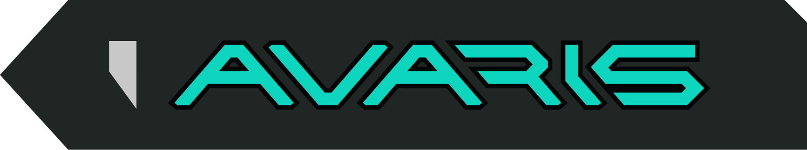
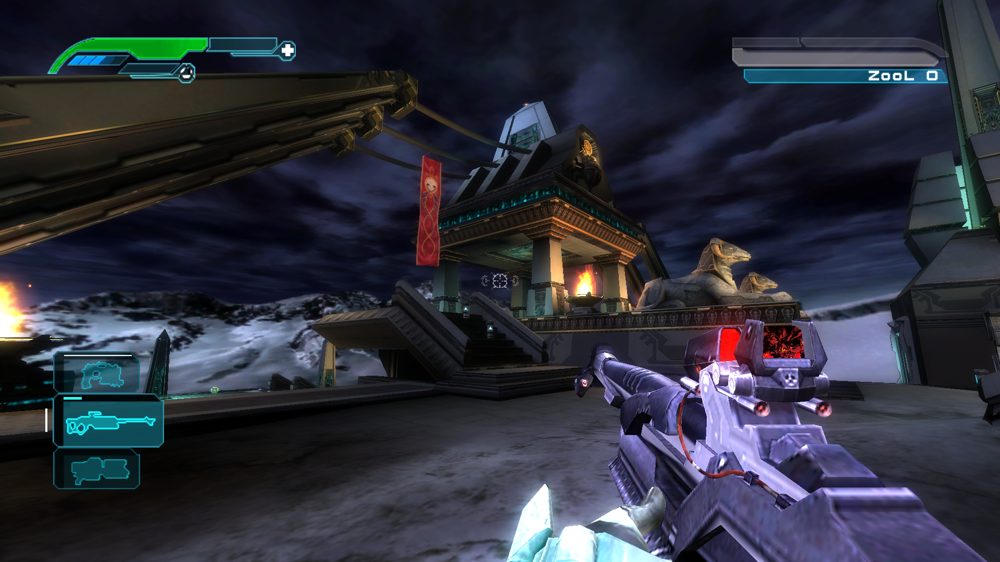
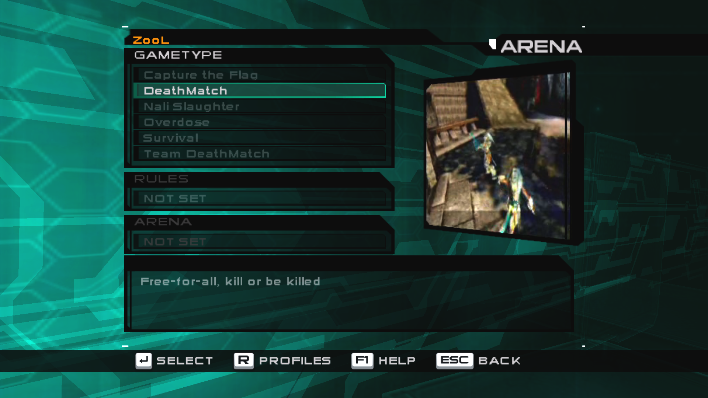
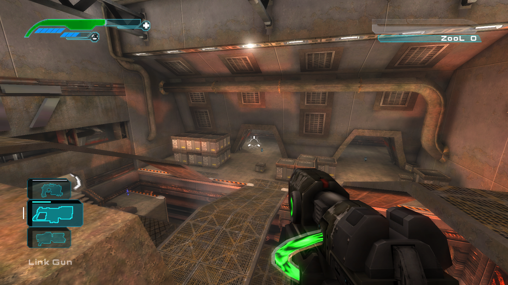

**Avaris** is a matching decompilation and native PC port of *Unreal Championship 2: The Liandri Conflict* (Xbox, 2005).

The decomp rebuilds the shipped Xbox executable byte for byte. The PC port is built from that same source. It runs on Windows with no emulation.

> **No code here yet.** For now this repository only tracks the project and its progress. The source will be published later.

## Screenshots

 Any resolution at any frame rate, uncapped or with vsync. The game logic stays correct, and online play runs on its own network tick, apart from the frame rate.

<table><tr>
<td width="50%"></td>
<td width="50%"></td>
</tr><tr>
<td align="center">The game's menus in widescreen, with keyboard or controller prompts.</td>
<td align="center">Mod support: a test mod adding the Link Gun, Deck17, as examples.</td>
</tr></table>

## Goals

- **A matching decomp.** One source tree rebuilds the game's executables exactly: first the non-LTCG `defaultLL.xbe` found on the disc, then the retail `default.xbe`. Each rebuilt image is checked against its hash.
- **A native PC port built from the same source.** The Xbox code paths (renderer, shaders, XACT audio, movies) run on a clean-room PC layer that reimplements the Xbox libraries. The game doesn't fall back on the engine's old PC paths, and it never emulates the console.
- **The retail game is the target.** The PC version plays like the retail Xbox game, without title-update changes. Anything that changes how the game plays, feels or behaves is an optional mod.
- **Bring your own disc.** Users provide their own copy of the game. The repository will never contain game assets.

## Why a decomp, not a recompilation

Another way to port an Xbox game is static recompilation: the shipped machine code is translated to C as it stands, and an emulated GPU and audio processor run underneath it. Avaris takes the longer road on purpose.

- **Real source, proven correct.** The game is rebuilt from readable C++ and UnrealScript, not machine code translated by a tool. The matching build proves that source is the game: compiled with the original compiler, it gives back the disc's executable byte for byte.
- **Native, not emulated.** The PC build has no emulated NV2A GPU or APU underneath. Every Xbox library the game calls (Direct3D, XACT, DirectSound, input, files) is reimplemented on modern APIs, clean-room, with no Microsoft or emulator code. The game's shaders and effects run on that layer, and so does the console's audio DSP: room reverb and 3D positioning sound as they did on the Xbox.
- **A clean program to ship.** The PC executable is compiled from source. It doesn't hold code lifted from the retail binary, and the disc is only read for its content.
- **Changeable like any source port.** Engine code can be fixed and extended directly. That's how the game got high frame rates with the game logic kept correct, any resolution, keyboard and mouse, a rebuilt UI, a mod loader and online play, none of which the Xbox build had.

## Progress

| Area | Status |
|---|---|
| **M1:** rebuilt `defaultLL.xbe` |  Byte-identical to the disc's (2026-10-05). It boots and plays in an emulator |
| **M2:** LL game code fully from source |  ~90% of the linked image built from our objects; 14,749 functions match exactly |
| **M3:** retail `default.xbe` |  Not started (whole-program LTCG link) |
| PC build |  Boots, plays every retail map and mode, split screen |
| Rendering |  NV2A shaders translated, high frame rates, any resolution, vsync and adaptive sync |
| Audio |  XACT banks and cues, music, XMV movies; the Xbox's audio DSP effects: I3DL2 environmental reverb and HRTF 3D positioning |
| Input |  Controllers (stable ports, two players), keyboard and mouse with on-screen prompts |
| Menus |  Rewritten UI with a responsive layout, built for widescreen; it covers the game's pages and works with a pad or keyboard and mouse |
| Mods |  Mod loader and API; first mods (menu, roster, audio) |
| Networking |  Online play works, tested over the internet; connect by IP from the console.  Server browser and online menus to come |
| Editor |  UnrealEd builds, cooks and runs maps in the PC game, including cut maps |

 done ·  in progress ·  not started

*Last updated: 2026-11-05.*

## Legal

Avaris isn't affiliated with Microsoft or Xbox. *Unreal Championship 2* and Unreal are trademarks of Epic Games, Inc. You need your own legally obtained copy of the game. This repository will never host the game's assets, executables, or Microsoft SDK code.
